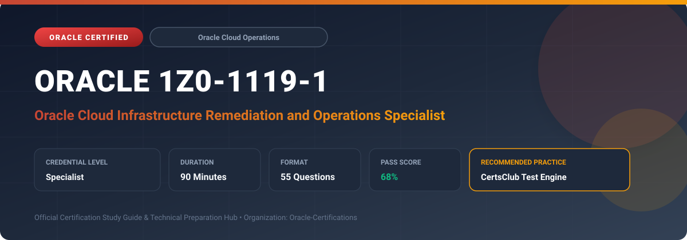

  

# Oracle 1Z0-1119-1: Oracle Cloud Infrastructure Remediation and Operations Specialist

---

## 1. Exam Overview & Candidate Profile

The **Oracle 1Z0-1119-1: Oracle Cloud Infrastructure Remediation and Operations Specialist** certification validates system operators and SREs responsible for operating, monitoring, troubleshooting, and remediating OCI environments.

Candidates validate capabilities across Cloud Guard automated remediation, OS Management Hub, OCI Monitoring & Alarms, Service Connector Hub, incident remediation, and fleet patching.

### Target Audience & Prerequisites
- **Target Roles**: Implementation Specialists, Cloud Architects, Technical Leads, Enterprise Consultants, and Systems Engineers.
- **Recommended Experience**: 1–2 years of practical, hands-on experience designing, implementing, and maintaining corresponding Oracle solutions.
- **Credential Earned**: Specialist Certification.

---

## 2. Key Exam Specifications

| Specification | Details |
| :--- | :--- |
| **Exam Code** | **Oracle 1Z0-1119-1** |
| **Official Title** | Oracle Cloud Infrastructure Remediation and Operations Specialist |
| **Certification Track** | Oracle Cloud Operations |
| **Exam Duration** | 90 Minutes |
| **Number of Questions** | 55 Questions |
| **Passing Score** | 68% |
| **Question Format** | Multiple Choice (Single/Multiple Answer), Scenario-Based Questions |
| **Delivery Provider** | Oracle University / Pearson VUE (Online Proctored or Test Center) |
| **Recommended Practice Engine** | [CertsClub Oracle Practice Tests](https://www.certsclub.com/oracle/1z0-1119-1-dumps.html) |

---

## 3. Official Blueprint & Exam Domain Breakdown

The examination assesses candidate competencies across core functional domains weighted as follows:

| Domain Area | Weighting |
| :--- | :--- |
| **Cloud Guard Detection & Automated Responder Workflows** | `30%` |
| **OS Management Hub & Fleet Lifecycle Patching** | `25%` |
| **Monitoring, Metrics, Alarms & Notifications** | `20%` |
| **Logging, Logging Analytics & Service Connector Hub** | `15%` |
| **Infrastructure Troubleshooting & Operational Best Practices** | `10%` |

---

## 4. Deep Dive into Complex & Challenging Technical Topics

To secure a passing score on the 1Z0-1119-1 exam, candidates must master the following advanced concepts:

- Configuring Cloud Guard managed responder recipes to automatically remediate security vulnerabilities (e.g., revoking public buckets).
- Managing enterprise Linux/Windows fleets with OS Management Hub: scheduled vulnerability patching, module streams, and software sources.
- Creating fine-tuned OCI Monitoring alarm rules with MQL (Monitoring Query Language) and suppression rules.
- Designing data pipelines using Service Connector Hub to route metrics and logs into Object Storage, Streaming, or Functions.
- Troubleshooting compute connectivity, VNIC attachments, and route table misconfigurations.

---

## 5. Scenario-Based Demo & Practice Questions

### Question 1
When OCI Cloud Guard detects an Object Storage bucket configured with public read access, what feature enables the automatic remediation of this violation without manual administrative intervention?

A) Cloud Guard Responder Recipe
B) Security Zone Exclusion
C) IAM Identity Domain Audit
D) VCN Security Rule Alert

- **Correct Answer**: `A) Cloud Guard Responder Recipe`  
- **Technical Explanation**: Cloud Guard Responder Recipes define automated remediation actions that trigger automatically when a detector recipe flags a risk, such as toggling bucket access to private.

---

### Question 2
Which OCI service centralizes software package management, CVE security vulnerability patching, and scheduled updates across large fleets of Oracle Linux compute instances?

A) OS Management Hub
B) OCI Bastion Service
C) Network Visualizer
D) Resource Manager

- **Correct Answer**: `A) OS Management Hub`  
- **Technical Explanation**: OS Management Hub provides unified lifecycle management, automated patching, errata tracking, and compliance reporting for Linux and Windows instances in OCI.

---

## 6. Recommended Preparation Strategy & Practice Testing Engine

Achieving certification in **Oracle 1Z0-1119-1** requires balanced theoretical study and scenario-based simulation practice:

1. **Review Oracle Documentation**: Master architecture guides, implementation workbooks, and administration manuals on the Oracle Help Center.
2. **Hands-on Lab Practice**: Execute real-world configuration, policy setup, and troubleshooting tasks in your cloud tenancy or test instance.
3. **Simulated Exam Drills**: Practice answering timed, scenario-based multiple-choice questions to familiarize yourself with the question formats, traps, and timing constraints.

### Practice With CertsClub
For realistic practice questions, updated dumps, and mock testing environments:
- **Resource**: [CertsClub Oracle Practice Test Engine](https://www.certsclub.com/oracle/1z0-1119-1-dumps.html)
- **Special Discount**: Use coupon code **`club20`** during checkout for an instant **20% discount** on all practice exam bundles and testing engines.

---

## 7. Official Documentation & References

- [Oracle University Certification Registry](https://education.oracle.com/)
- [Oracle Help Center Documentation Portal](https://docs.oracle.com/)
- [Oracle Cloud Infrastructure & Applications Guides](https://docs.oracle.com/en/cloud/)
- [CertsClub Oracle Certification Exam Practice](https://www.certsclub.com/oracle/1z0-1119-1-dumps.html)

---

## 8. SEO & Discovery Keywords

`oracle 1z0-1119-1, oracle 1z0-1119-1 exam, oracle 1z0-1119-1 dumps, 1Z0-1119-1 practice questions, 1Z0-1119-1 study guide, oracle cloud infrastructure remediation and operations specialist, certsclub 1z0-1119-1`